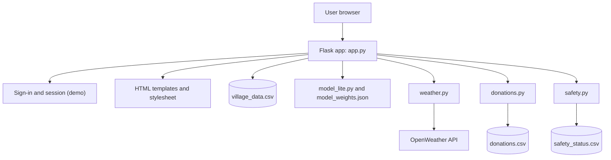
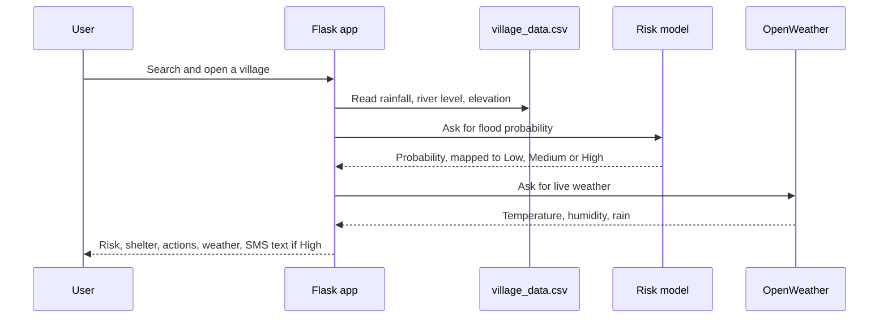

# Abhaas: Technical Document

This document describes how the Abhaas prototype is built, how data flows through it, and how to test it.

## 1. Overview

Abhaas is a server-rendered web application written in Python with Flask. The browser requests a page, Flask looks up data, fills an HTML template and returns the finished page. There is no separate front-end framework and no database. Data lives in CSV files.

## 2. System diagram



## 3. How a risk lookup works



## 4. Components

| Component | File | Purpose |
|---|---|---|
| Web app and routes | `app.py` | Pages, language text (English and Hindi), shelters, recommended actions, SMS message text |
| Risk model | `model_lite.py`, `model_weights.json` | Logistic regression on rainfall, river level and elevation. Below 33% is Low, below 66% is Medium, otherwise High |
| Live weather | `weather.py` | Finds the place with OpenWeather's geocoding and fetches current weather. Falls back to the state's main city, with a note |
| Help Board | `donations.py`, `donations.csv` | Posts that request or offer help |
| Safety Board | `safety.py`, `safety_status.csv` | "I am safe" check-ins |
| Templates | `templates/` | Home, result, alerts, boards, login |
| Training scripts | `create_dataset.py`, `train_lite.py` | Generate the dataset and train the model |

Main routes: `/` (search), `/risk/<village>` (result), `/alerts`, `/board`, `/safety`, `/login`, `/logout`, `/setlang/<lang>`.

## 5. Data

`village_data.csv` has 252 places and these columns: `village, state, rainfall_mm, river_level_m, elevation_m, flooded_before`.

Sample rows:

```
Cooch Behar,West Bengal,335,2.5,117,1
Namchi,Sikkim,168,4.6,79,0
```

**The values are simulated.** `create_dataset.py` generates them randomly, so the risk results demonstrate the pipeline and do not describe real flood risk. Only the weather panel uses live data.

## 6. Configuration

| Variable | Purpose |
|---|---|
| `OPENWEATHER_API_KEY` | OpenWeather API key, stored in a local `.env` file (see `.env.example`) |

## 7. Test cases

**Automated:** `python test_login.py` checks the account helpers in `users.py` (register, verify, wrong password).

**Manual checks:**

| # | Steps | Expected result |
|---|---|---|
| 1 | Open `/` without signing in | Redirected to the login page |
| 2 | Sign in with any name and email | Home page opens |
| 3 | Type `Mal` in the search box | Malda appears in the suggestions |
| 4 | Open Malda | Risk level, shelter, actions and weather are shown |
| 5 | Open Active Flood Alerts | High-risk villages are listed with SMS-ready text |
| 6 | Post a request on the Help Board | The post appears in the list |
| 7 | Submit the Safety Board form | The name appears under people confirmed safe |
| 8 | Switch the language to Hindi | Interface text changes to Hindi |

## 8. Known limitations

- Risk data is simulated.
- The sign-in is a demo and does not check passwords.
- CSV storage does not suit many users, and it is not kept on hosts with read-only or temporary storage.
- Weather lookup by place name can fall back to the state's main city.

## 9. Planned architecture

Forecast rainfall and modelled river-flow data per place, an explainable risk rule that shows its reasons, a database in place of CSV files, real accounts, and links to official alerts.
